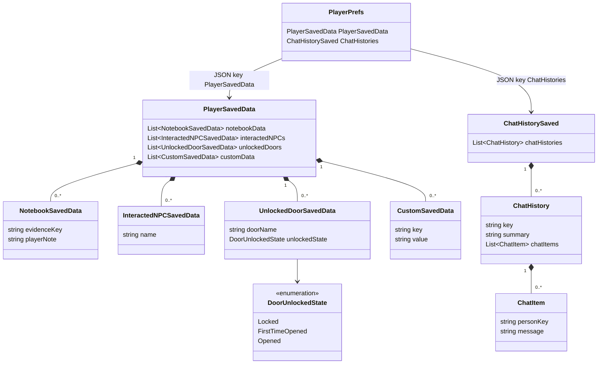
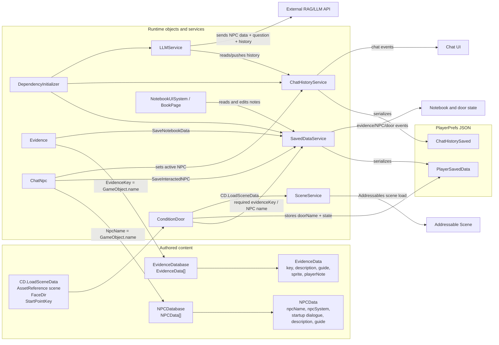

# Project Data Model

This diagram describes the model currently implemented in the Unity runtime.
It separates content authored in ScriptableObjects, runtime services, and data
serialized to `PlayerPrefs`.

## Persistence model

## Runtime and authored-content relationships

## Key invariants

- `EvidenceData.key`, `NPCData.npcName`, `ConditionDoor.DoorName`, and
  `ChatHistory.key` are string identity contracts. Runtime objects normally
  derive these identities from their GameObject names.
- Evidence notes are the progression signal for collected evidence. Saving an
  empty note still creates a `NotebookSavedData` record and makes the evidence
  count as collected.
- A `ConditionDoor` unlocks when every required evidence key has a saved note
  and every required NPC name has been recorded as interacted with. Its state
  progresses from `Locked` to `FirstTimeOpened` to `Opened`.
- `EvidenceDatabase` mirrors saved player notes back into its in-memory
  `EvidenceData.playerNote` values through `OnEvidenceNoteSaved`; the
  ScriptableObject remains the authored content source.
- Chat history is keyed by NPC name and stores both a compact `summary` and
  individual `ChatItem` messages. `LLMService` uses both when building a
  request.
- `CD.LoadSceneData` is transient scene-transition data. It is not part of
  `PlayerSavedData`; `SceneService` holds it as `CurrentLoadSceneData` while
  loading an Addressable scene.

## Source map

- [SavedDataService.cs](Assets/Scripts/Services/SaveLoad/SavedDataService.cs)
- [ChatHistoryService.cs](Assets/Scripts/Services/ChatServices/ChatHistoryService.cs)
- [EvidenceDatabase.cs](Assets/Scripts/ScriptableObjects/EvidenceDatabase.cs)
- [NPCDatabase.cs](Assets/Scripts/ScriptableObjects/NPCDatabase.cs)
- [Evidence.cs](Assets/Scripts/Game/Evidence.cs)
- [ChatNpc.cs](Assets/Scripts/Game/Npcs/ChatNpc.cs)
- [ConditionDoor.cs](Assets/Scripts/Game/ConditionDoor.cs)
- [CommonData.cs](Assets/Scripts/Utils/CommonData.cs)
- [SceneService.cs](Assets/Scripts/Services/SceneService.cs)
